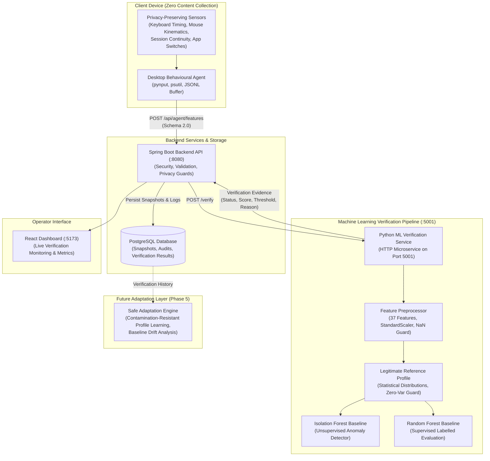

# Cyber Doppelgänger — Architecture Overview
> **Safe Adaptive Behavioural Identity & Continuous User Verification**

## 1. System Architecture Flowchart

---

## 2. Component Status Matrix

| Component | Status | Responsibilities & Capabilities |
| :--- | :---: | :--- |
| **Desktop Behavioural Agent** | **Implemented (Phase 2)** | Keystroke dwell/flight times, mouse kinematics, session continuity, local JSONL buffering. |
| **Privacy Validation Guard** | **Implemented (Phase 2 & 3)** | Absolute exclusion of raw letters, typed text, passwords, URLs, and screen pixels. |
| **Spring Boot Backend** | **Implemented (Phase 3)** | Ingestion (`/api/agent/features`), retrieval (`/api/behaviour`), JWT auth, audit logging. |
| **PostgreSQL Storage** | **Implemented (Phase 3 & 4)** | Tables for `users`, `devices`, `sessions`, `behavioural_feature_snapshots`, `verification_results`, `audit_logs`. |
| **Feature Preprocessor** | **Implemented (Phase 4)** | 37 approved numerical behavioural features, NaN/Inf rejection, schema 2.0 validation, `StandardScaler`. |
| **Reference Profile** | **Implemented (Phase 4)** | Immutable statistical distributions (mean, std, median, IQR) for legitimate user baselines. |
| **Isolation Forest Detector**| **Implemented (Phase 4)** | 5th-percentile threshold calibration, logistic confidence mapping, `VERIFIED`/`UNCERTAIN`/`DEVIATION`. |
| **Random Forest Baseline**   | **Implemented (Phase 4)** | Supervised baseline with multi-class impostor verification guard and confidence calibration. |
| **ML Microservice**          | **Implemented (Phase 4)** | Zero-dependency HTTP service on port 5001 (`/health`, `/models/status`, `/verify`). |
| **Backend ML Integration**   | **Implemented (Phase 4)** | `POST /api/verification/process`, persistence to `verification_results`, offline resilience. |
| **Safe Adaptation Engine**   | **Planned (Phase 5)** | Contamination-resistant profile evolution and drift learning. (Intentionally omitted in Phase 4). |
| **React Dashboard**          | **Implemented (Phase 1-3)** | Health monitoring, shell layout, and live backend connectivity. |
